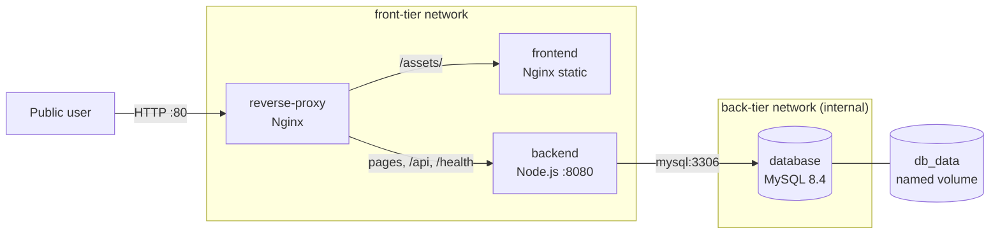

# EpicBook Production


A production-style deployment of **The EpicBook**, a Node.js bookstore application, on AWS EC2 with Docker Compose. It runs behind an Nginx reverse proxy, stores data in MySQL on a named volume, and deploys through a GitHub Actions pipeline.

The application code comes from [pravinmishraaws/theepicbook](https://github.com/pravinmishraaws/theepicbook). The container, networking, health-check, backup, logging and CI/CD setup in this repository is my work.

## Architecture



- The reverse proxy is the **only** service that publishes a host port (80).
- The backend sits on both networks. `back-tier` is `internal: true`, so the database has no route to or from the outside.
- The browser talks to a single origin, so **no CORS configuration is needed**.

## Highlights

- **Small, hardened images:** the backend uses a multi-stage build on Alpine with production dependencies only, and runs as the non-root `node` user. The image is **261 MB, down from 1651 MB** for a single-stage build (84% smaller).
- **Health-gated startup:** database healthy, then backend healthy, then proxy. Every dependency uses `condition: service_healthy`.
- **Persistent data:** MySQL data lives in the `db_data` volume and survives `docker compose down`.
- **Tested backup and restore:** logical backups with `mysqldump` to a host folder, with a documented restore drill.
- **Structured logs:** Nginx writes JSON access logs to a host bind mount (`logs/proxy/`). Backend logs go to stdout.
- **Secrets stay out of Git:** all credentials come from a local `.env` file, and only `.env.example` is committed.
- **CI/CD:** every push to `main` builds SHA-tagged images, pushes them to GHCR and deploys to the VM.

## Tech stack

| Layer | Technology |
|---|---|
| Application | Node.js 22, Express, Handlebars, Sequelize |
| Database | MySQL 8.4 |
| Proxy and static files | Nginx (stable-alpine) |
| Containers | Docker Engine, Docker Compose v2 |
| Infrastructure | AWS EC2 (Ubuntu 22.04), Elastic IP, security group, provisioned with Terraform |
| CI/CD | GitHub Actions, GitHub Container Registry |

## Project structure

```
.
├── backend/              Node.js app, views, models, routes, Dockerfile
├── frontend/             static assets (public/) and Nginx Dockerfile
├── proxy/nginx.conf      reverse proxy routing and JSON log format
├── db/                   schema and seed SQL, mounted into MySQL on first start
├── docs/                 environment, health checks, routing, backup and runbook notes
├── scripts/deploy.sh     deploy and rollback script used by the pipeline
├── .github/workflows/    CI/CD pipeline
├── docker-compose.yml
└── .env.example          variable names with placeholder values
```

## Quick start

Requirements: Docker Engine with Compose v2, and Git.

```bash
git clone https://github.com/solutionkingz-glitch/epicbook-production.git
cd epicbook-production
cp .env.example .env
# replace every "replace_me" with a strong random value, for example: openssl rand -hex 12
docker compose up -d --build --wait
curl -i http://localhost/health
```

Then open `http://<VM_PUBLIC_IP>` (or `http://localhost` locally).

## Configuration

Set these in `.env` (names only here, never commit real values):

| Variable | Purpose |
|---|---|
| `NODE_ENV`, `PORT` | backend runtime mode and internal port (8080) |
| `DB_HOST`, `DB_PORT`, `DB_NAME`, `DB_USER`, `DB_PASSWORD` | backend database connection (`DB_HOST` is the Compose service name `database`) |
| `MYSQL_ROOT_PASSWORD`, `MYSQL_DATABASE`, `MYSQL_USER`, `MYSQL_PASSWORD` | MySQL container initialization |

## Health checks and startup order

| Service | Check |
|---|---|
| database | `mysqladmin ping` over a real TCP connection |
| backend | `GET /health`, which runs a database query and returns 200 only if it succeeds (503 otherwise) |
| frontend | HTTP request for a static file served by Nginx |
| reverse-proxy | `GET /health` through Nginx, which proves the proxy can reach the backend |

## Routing

| Path | Goes to |
|---|---|
| `/assets/*` | frontend (static CSS, JS, images) |
| `/api/*` | backend |
| `/health` | backend |
| `/` and all other pages | backend (server-rendered) |

## Backup and restore

```bash
# backup (written to the host, outside the container and the volume)
mkdir -p backups
docker compose exec -T database sh -c 'mysqldump -u root -p"$MYSQL_ROOT_PASSWORD" --single-transaction --routines --triggers --no-tablespaces bookstore' > backups/epicbook_$(date +%Y%m%d_%H%M%S).sql

# restore
docker compose stop backend
docker compose exec -T database sh -c 'mysql -u root -p"$MYSQL_ROOT_PASSWORD" bookstore' < backups/<file>.sql
docker compose start backend
```

Stop the stack with `docker compose down`. **Never add `-v` on a live system**, because it deletes the `db_data` volume and all data. Details and the retention plan are in `docs/05-persistence-and-backup.md`.

## Logging

- Proxy access and error logs: `logs/proxy/` on the host, in JSON, kept across container restarts.
- Backend logs: `docker compose logs backend --tail=50`.
- Only the path, status, size and timing are logged. Headers, cookies, query strings and request bodies are not.

## CI/CD

`.github/workflows/deploy.yml` runs on every push to `main`:

1. Builds the backend and frontend images and pushes them to GHCR, tagged with the Git commit SHA.
2. Opens SSH in the security group for the runner's IP only, then closes it again in a step that always runs.
3. Connects with a dedicated deploy key (host-key verification on), pulls the new images and restarts the stack with `scripts/deploy.sh`.
4. Rolls back to the previous image tags if the new version does not become healthy.
5. Checks the public `/health` endpoint.

Credentials live only in GitHub Actions secrets: `VM_HOST`, `VM_USER`, `VM_SSH_KEY`, `VM_KNOWN_HOSTS`, `SG_ID`, `AWS_ACCESS_KEY_ID`, `AWS_SECRET_ACCESS_KEY` and `AWS_REGION`.

## Reliability tests

Stopping the backend makes the proxy return an unavailable response, and stopping the database makes `/health` report failure. In both cases the stack recovers once the service is started again, and no data or volume is touched. The procedures are in `docs/06-operations-runbook.md`.

## Security notes

- Only port 80 is public. SSH is limited to one IP address. MySQL, the backend and the frontend are never published.
- The backend runs as a non-root user.
- `.env`, backups and logs are listed in `.gitignore`. The password that the upstream repository kept in `config.json` has been removed.

## Known limitations

- HTTP only. The next step is a domain name with HTTPS (Let's Encrypt).
- The application has no user authentication.
- Two upstream bugs remain: `DELETE /api/cart/delete` never sends a response, and `POST /api/cart` with an unknown book ID can crash the Node process (the container restarts automatically).
- Backups are manual. A production setup would schedule them with cron and copy them off the host.

## Documentation

- `docs/02-env-and-ports.md`: environment variables, ports and persistent data
- `docs/03-healthchecks-and-depends-on.md`: health checks and startup order
- `docs/04-proxy-routing-and-cors.md`: proxy routing and why CORS is not needed
- `docs/05-persistence-and-backup.md`: backup plan and restore procedure
- `docs/06-operations-runbook.md`: day-to-day operations and recovery
- `docs/APPLICATION.md`: the original application documentation

## Credits and license

The EpicBook application was created by [Pravin Mishra](https://github.com/pravinmishraaws) and The CloudAdvisory. This project is released under the MIT license, as is the original.

Deployment by **Kingsley Erhatiemwonmon**.
